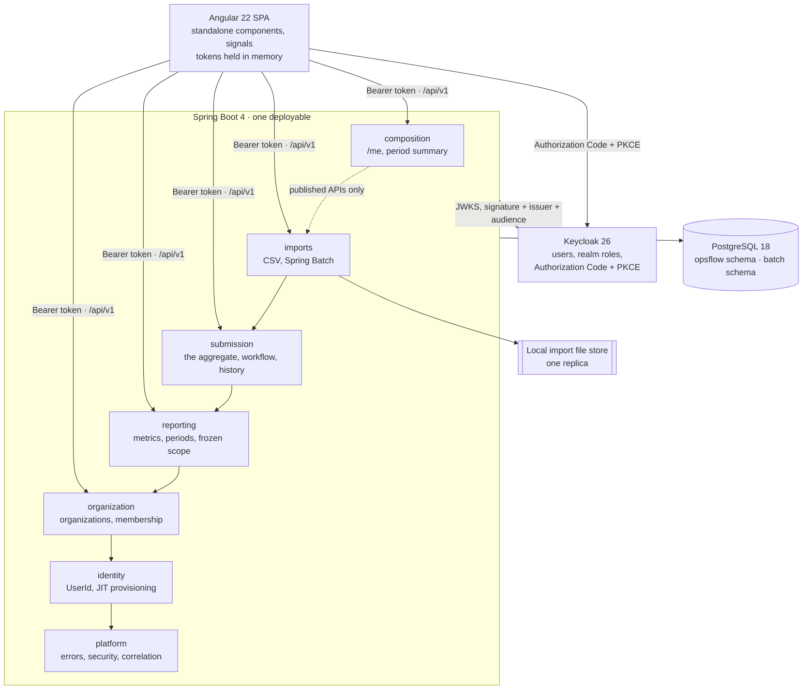

# Architecture

OpsFlow is a **modular monolith**: one deployable, six business modules plus a platform layer and
a thin composition layer, with boundaries enforced by tests rather than by convention.

## The system



## Module order

```text
platform → identity → organization → reporting → submission → imports

composition → every module, through published APIs only; nothing depends on composition
```

The order is total, so cycles are impossible by construction. `ModuleBoundaryTest` fails the
build on any back-edge, and the arrows above are exactly the ones it permits.

| Module | Owns | Published API |
|---|---|---|
| `platform` | nothing | error contract, `Role`, `PageResponse`, correlation id |
| `identity` | `app_user` | `UserId`, `Actor`, `UserDirectory`, `CurrentUserProvider` |
| `organization` | `organization`, `org_membership` | `OrganizationAccess`, `OrganizationDirectory` |
| `reporting` | `metric_definition`, `reporting_period(_metric,_organization)` | `MetricCatalog`, `PeriodQuery`, `ScopedMetric` |
| `submission` | `submission`, `submission_value`, `submission_transition` | `SubmissionImportService`, `SubmissionQuery` |
| `imports` | `import_job`, `import_row_error`, `batch.*` | none — it serves HTTP |
| `composition` | nothing | none |

Packages are organised by capability, not by technical layer: each module holds
`domain` / `application` / `infrastructure` / `api` beneath its own root, and the root package is
the only thing another module may reference.

## How the boundaries are actually enforced

Three levels, all of them failing the build rather than a review:

1. **Code** — ArchUnit checks the module order, that nothing reaches past another module's root
   package, that `..domain..` imports no Spring, JPA or Jackson, and that `@Transactional` appears
   only in `..application..`.
2. **Queries** — a source scan fails if any module names a table another module owns. ArchUnit
   cannot see inside a SQL string, so this is a separate check.
3. **Schema** — a Testcontainers test asserts no foreign key points against the dependency
   direction, so the database cannot express a relationship the code is forbidden to have.

## The decisions worth knowing

Each links to the ADR that argues it, rather than repeating the argument here.

| Question | Short answer | Where |
|---|---|---|
| Why a modular monolith? | One deployable, enforced seams, no distributed transactions for a workflow that is inherently transactional | [ADR-0001](adr/0001-modular-monolith.md), [ADR-0002](adr/0002-package-modules-not-gradle-subprojects.md) |
| How does authorization work? | Keycloak owns *what kind of user*; the database owns *which organizations*. Roles come from the token per request and are never persisted | [ADR-0003](adr/0003-identity-and-authorization.md) |
| Why an application-owned `UserId`? | The OIDC `sub` is an external identifier; using it as a primary key hands ownership of every foreign key to the identity provider | [ADR-0003](adr/0003-identity-and-authorization.md) |
| Why freeze a period's scope? | Otherwise history is mutable: create an organization in July and last quarter's completion silently drops | [ADR-0005](adr/0005-workflow-inside-submission.md) |
| How is concurrency handled? | Optimistic locking on every aggregate, plus database constraints for the races application code cannot win: one submission per (organization, period), no overlapping periods, one live import per scope | [ADR-0001](adr/0001-modular-monolith.md) |
| Why can CSV import not bypass the aggregate? | A second writer would mean a second, weaker set of invariants. Efficiency comes from grouping a chunk by organization | [ADR-0006](adr/0006-imports-write-through-the-submission-aggregate.md) |
| How does idempotency work? | `(created_by, Idempotency-Key)` is unique, and the fingerprint covers the file, the period and the scope | [ADR-0006](adr/0006-imports-write-through-the-submission-aggregate.md) |
| What happens if an import process dies? | It is failed as interrupted with its last committed counts, never silently resumed; a job that never started is re-enqueued | [ADR-0009](adr/0009-single-replica-imports-and-recovery.md) |
| Where do tokens live in the browser? | In memory. Only the token-free OIDC handshake state goes to `sessionStorage` | [ADR-0011](adr/0011-browser-token-storage.md) |
| What does an error look like? | RFC 9457 `application/problem+json` with a stable `code` and the correlation id, including 500s | [ADR-0010](adr/0010-error-contract.md) |

## The submission workflow

```text
DRAFT ──submit──▶ SUBMITTED ──claim──▶ UNDER_REVIEW ──approve──▶ APPROVED
  ▲                   │                     │
  └────withdraw───────┘      ┌──release─────┤
                             ▼              ▼
                        SUBMITTED       REJECTED ──submit──▶ SUBMITTED
```

`DRAFT` and `REJECTED` accept value edits; nothing else does, and `APPROVED` is terminal. Every
transition appends one row to `submission_transition` with actor, reason and time. Saving values
appends none — it is not a status change.

## Data ownership

PostgreSQL is the only datastore. Flyway owns every table in it, including Spring Batch's
metadata, which lives in its own `batch` schema. Hibernate never creates or alters anything:
`ddl-auto: validate` means a mismatch between entities and migrations fails startup.

Invariants live in the database wherever they can be expressed there — unique indexes, check
constraints, a GiST exclusion constraint against overlapping periods, and a partial unique index
that serialises concurrent imports for one scope. Application code that checks first and acts
second loses those races; the database does not.
